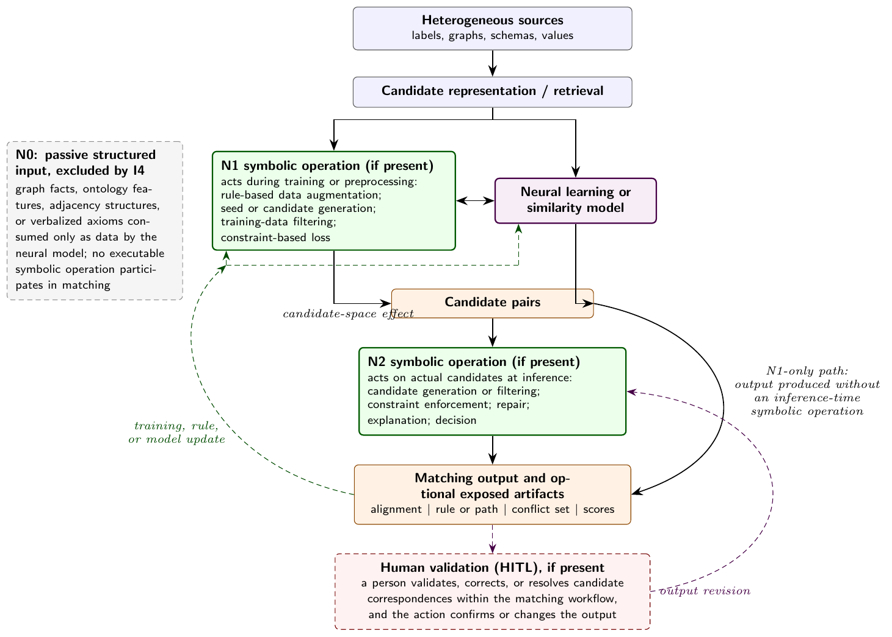

# Coding guide

How each included study was coded on the analytical dimensions of the review. This guide
replaces the appendix on the coding procedure that was in the manuscript. The framework
itself (stage, function, explanation, human validation) is defined in *Background*
(Section 2) and summarised in *Extraction and coding* (Section 3.3) of the article.
Coded values are in [`data/extraction/`](../data/extraction/).

*Analytical framework of the article. N1 and N2 are the stages at which an executable
symbolic operation acts; N0 marks passive structured input, which fails criterion I4.*

## 1. Coding a study in five steps

Code every study in this order, always from the full text, never from the abstract.

1. **Read the architecture or method section in full.** The abstract and introduction are
   not enough: opposite verdicts were once reached on the same paper because the first
   reading stopped early.
2. **Look at the mechanism, not the vocabulary.** Does a formal operator actually execute
   (inference, constraint, rule application, propagation, a fixpoint)? Check the traps in
   section 5 first. If the knowledge structure is only flattened into features, graph edges
   or tokens for a network that decides alone, the study is **N0** and is excluded under I4.
3. **Code the stage** of the symbolic operation and copy the decisive passage with its
   section. Training or preprocessing gives **N1**; operation on actual candidates at
   inference gives **N2**; a system acting at both stages gets a dominant stage and is
   flagged as mixed.
4. **Code the symbolic function.** List every active function, most important first,
   and mark the dominant one.
5. **Code the remaining axes** (Kautz type, knowledge-exploitation strategy, knowledge
   source, explanation, human validation, application context), each with a localised
   justification.

## 2. Axes and where they are recorded

| Axis | Code | Column |
|---|---|---|
| Architectural coupling | Kautz Types I-VI | `coding.csv: kautz_type` |
| Knowledge-exploitation strategy (D3) | Factual / Structure-based / Statistical-neural / Logic-based | `coding.csv: strategy` |
| Stage of symbolic intervention | N1 / N2, secondary stage, mixed flag | `coding.csv: stage, stage_secondary, mixed_stage` |
| Symbolic function (D5) | Candidate generation / Constraint enforcement / Repair / Explanation / Decision (multi-valued) | `coding.csv: function, functions_present` |
| Knowledge source (D2) | Lexical-taxonomic / Domain ontology-KG / Pre-trained neural / Hybrid | `context.csv: knowledge_source` |
| Explanation | none / score-only / trace / native, and its evaluation | `explanation_hitl.csv` |
| Human validation (HITL) | presence, stage, action, effect on output, effort measure | `explanation_hitl.csv`, `rq2_audit.csv` |
| Application context (D7) | domain, task, languages, multilinguality, heterogeneity, resources | `context.csv` |

One coder (the first author) coded and validated all 27 studies from the full text;
mixed-stage studies and boundary cases were adjudicated with the second author. No
independent second coding was done, so inter-rater agreement is not available (see
*Limitations*).

Dimension numbers follow the extraction form. D1 (infusion level) and D4 (linking
strategy) were dropped during the review because they could not be coded reliably; the
remaining dimensions keep their original numbers.

## 3. Stage of symbolic intervention

The stage records **when an executable symbolic operation affects the matcher**.

| Code | Rule | Status |
|---|---|---|
| N0 | The knowledge graph or ontology is flattened into features, an adjacency matrix, or verbalised tokens. The symbolic side does not reason; it supplies data to a network that decides alone. | excluded (I4, condition B) |
| N1 | The symbolic operation acts during training or preprocessing: a constraint in the loss, reasoning that enriches the input, rules that generate training pairs or candidates, filtering of training data. | included |
| N2 | The symbolic operation acts on actual candidate correspondences at inference: it filters, propagates, repairs, explains or decides. | included |

**Decision questions**

1. *Does the symbolic side reason, or only supply data?* If no inference, formal constraint
   or rule is applied, the study is N0.
2. *When does it act?* During training or before the encoder: N1. On a real pair to be
   matched: N2.
3. *Both?* Code the dominant stage, record the secondary stage and set the mixed flag.
   Do not resolve a genuinely ambiguous case alone: it changes the reported distribution
   and goes to adjudication.

**Worked examples** (validated codings)

- **SLHCat, N1.** Hierarchical and lexical rules generate distant-supervision pairs used
  to fine-tune BERT. No symbolic operation touches the final candidates; BERT alone outputs
  the class distribution.
- **NeuSymEA, N2 mixed.** Symbolic inference provides a training signal *and* takes part
  in the final output. Dominant stage N2 because it acts on real correspondences.
- **CIDER-LM, N1 mixed.** HermiT reasoning shapes the neural representations upstream; a
  secondary type filter acts after matching. Dominant stage N1.
- **FCA-Map + SBERT, N2 mixed.** Lexical FCA provides training examples (N1); a structural
  lattice validates SBERT candidates at inference (N2). Coded N2, with constraint
  enforcement as dominant function.
- **DeepFCA, sensitivity case.** Coded N1; reclassifying it to N2 changes the distribution
  from 13 N1 / 14 N2 to 12 N1 / 15 N2. Reported as a sensitivity analysis.

**What the stage is not.** It is not a maturity or quality scale: a sophisticated logical
constraint in a loss (N1) can be more expressive than a thin inference-time heuristic (N2),
and an inference-time reasoner is not necessarily explainable. It is never inferred from
the authors' wording, and never coded from an abstract.

## 4. The other axes

### Kautz type (architecture)

Position of the neural-symbolic coupling at system level, following Kautz (2022):
Type I, neural processing of symbolic input; Type II, a symbolic solver calling neural
subroutines; Type III, neural and symbolic co-routines exchanging intermediate results;
Type IV, symbolic knowledge compiled into the training data of a neural model; Type V,
symbolic constraints in the learning objective or architecture; Type VI, reasoning fully
inside the neural substrate. Kautz is used because it accepts both orientations (symbolic
engine with neural helpers, or neural learner informed by knowledge).

### Knowledge-exploitation strategy (D3)

How structured knowledge is exploited, adapted from Portisch et al. (2025). Code the
dominant strategy, independently of the stage.

| Value | Rule |
|---|---|
| Factual | A fact is looked up and used as is (WordNet synonym, translation call). |
| Structure-based | The graph or taxonomy structure is exploited: paths, sub-tree overlap, common depth, traversal. |
| Statistical-neural | Statistics or networks are applied to the resource (TF-IDF, embeddings, pre-trained models). |
| Logic-based | Reasoning is applied: rules, axioms, transitivity, description-logic, fuzzy or probabilistic inference. |

*Boundary case, SMoG.* Its stateful SPARQL operator expands, filters, propagates and prunes
the candidate space at inference, but performs no deductive closure, satisfiability check
or rule inference. Coded Structure-based, N2, candidate generation (explanation secondary).
The returned paths are inspectable search traces, not logical proofs. Under a stricter
deductive-only definition this study would fall outside the corpus.

### Symbolic function (D5)

What work the symbolic component does in the matching pipeline. The only multi-valued
axis: list every active function joined by "+", most important first; only the dominant
one is counted.

| Value | Rule | Stage |
|---|---|---|
| Candidate generation | Creates or restricts the comparison space before scoring: rule-generated seeds, symbolic blocking, structural restriction. | N1 or N2 |
| Constraint enforcement | Penalises or removes incompatible pairs: disjointness, type, cardinality, subsumption coherence. | N1 or N2 |
| Repair | Modifies a produced alignment or ontology to restore coherence. | N2 by definition |
| Explanation | Produces an inspectable justification for a correspondence. | N2 by definition |
| Decision | Produces or arbitrates the final matching verdict (probabilistic reasoner, fuzzy engine, constraint system whose fixpoint is the alignment). | N2 by definition |

Stage and function are coded separately but are **not independent**: repair, explanation
and decision presuppose a produced correspondence and can only occur at inference. Only
candidate generation and constraint enforcement can occur at either stage, so only their
split between N1 and N2 is an empirical result.

*Examples.* NeuSymEA: decision + explanation, counted as decision. HMatch: explanation
dominant (link keys explain and regenerate identity links). BERTMap: repair of incoherent
outputs.

### Knowledge source (D2)

External background knowledge consulted by the system, beyond the sources being matched.
`none` when there is none; `Other` when it fits none of the four categories.

| Value | Examples |
|---|---|
| Lexical-taxonomic | dictionaries, thesauri, taxonomies (WordNet, BabelNet), translation dictionaries |
| Domain ontology-KG | domain ontologies and knowledge graphs (UMLS, FMA, DBpedia, Wikidata), SPARQL endpoints |
| Pre-trained neural | pre-trained models used as a knowledge source (BERT, BioBERT, fastText, sentence encoders, external LLMs) |
| Hybrid | at least two of the above consulted explicitly |

### Explanation

Explanation and human validation are two separate axes; never infer one from the other,
or either from the mere presence of a symbolic formalism.

| Mode | Rule |
|---|---|
| none | no justification of individual decisions |
| score-only | a score or confidence without structured justification |
| trace | a rule, path, conflict set or derivation available as a by-product |
| native | producing an inspectable justification is an explicit design objective |

Evaluation of the explanation is coded separately: `none`, `example` (illustrative
examples only), `quantitative proxy` (a computed measure of the artifact), `user study`.

### Human validation (HITL)

HITL is present only when **a person acts in the matching workflow and the action
validates, corrects or changes the output**. Record the stage (preparation, training,
validation, inference, repair), the action (label, validate, correct, set a threshold,
resolve a conflict), whether it changes the output, and any reported effort (number of
decisions, time, iterations, saving ratio).

These are **not** HITL: dataset annotation, gold-standard construction, manual parameter
choices, an LLM or simulated oracle standing in for a person, a future-work statement.

Because RQ2 rests on absences, every study was audited for an expert feedback loop, an
explanation user study and a human-effort measure. A "no" needs either a localised passage
or a documented not-reported check across methods, evaluation, limitations and future work
(`rq2_audit.csv`).

### Application context (D7)

Domain; task; languages and language pairs; multilinguality, distinguishing **benchmark**
multilinguality (predefined language pairs with reference alignments) from **operational**
multilinguality (partial translations, inconsistent local terminology, no reference
alignment); heterogeneity (terminological, structural, linguistic, schematic, measurement);
dataset scale; code and data availability.

*Measurement heterogeneity* is coded "yes" only when units, aggregation levels, value
ranges, denominators, populations or reference periods are used as matching constraints
or evaluation dimensions.

### Evaluation practices

For each study: whether an ablation or component-variant analysis is reported, what is
varied, and whether one control **switches off the dominant symbolic operation** while the
rest of the system is kept (`ablation.csv`). Varying neural components, symbolic inputs,
parameters or subsidiary rules does not count as switching it off.

## 5. Terminological traps

Patterns that repeatedly misled label-based coding during full-text assessment.

- **"Symbolic similarity" or "symbol-based"** often means string similarity (Levenshtein,
  Jaro-Winkler, longest common substring). Not reasoning; condition A fails on the symbolic side.
- **A "logical reasoner" that is a language model** generating features for a network is
  not a symbolic component.
- **"Rules" that are geometric heuristics** on an embedding space (cluster radius, centroid,
  distance threshold) are not reasoning.
- **"Rules" that are lexical pattern matching** (regular expressions, parsers, keyword
  lists, unit templates) are not reasoning either.
- **A named reasoner** (PARIS, FCA, LogMap, HermiT, Pellet) must belong to the system's own
  mechanism, not to a baseline or the related work. Counting mentions is misleading.
- **Constraints stated in a prompt** count only if a formal operator executes them
  (solver, propagation, backtracking, fixpoint).
- **Natural-language "reasoning chains"** produced by a language model are not symbolic
  reasoning; "logic-based" describing an output format (an OWL expression) is not a mechanism.
- **Metaheuristics** (genetic algorithms, particle swarm) or systems declared non-neural
  fail condition A on the neural side.
- **Verbalised axioms** fed to an embedding model or LLM, and triples retrieved to feed a
  language model, are N0.
- **The symmetric trap, as frequent as the others:** under-reading a logical constraint in
  the loss, or a reasoner that filters training data, as N0 because the final decision is a
  cosine similarity. These are valid N1 mechanisms.

## 6. Coding rules

1. Code the stage from the actual mechanism, not from the last phase described. Identify
   every symbolic intervention, then the dominant one.
2. The stage carries no inclusion decision except N0. N1 and N2 are equally valid; their
   distribution is the result.
3. Only the symbolic function is multi-valued. Counts use the dominant function; secondary
   functions are reported qualitatively.
4. Every stage code needs a quoted decisive passage with its section (`coding.csv:
   evidence_quote, evidence_section`).
5. Never code the stage from an abstract.

## 7. Reliability (for a second coder)

The article reports single-coder coding. A second coder reproducing it should code blind
(full texts and this guide, without seeing `coding.csv`), report agreement separately for
stage, Kautz type, strategy and dominant function (raw agreement, Cohen's kappa and
Krippendorff's alpha, since rare categories such as repair and explanation can depress
kappa), and resolve each disagreement against the decisive passage.
